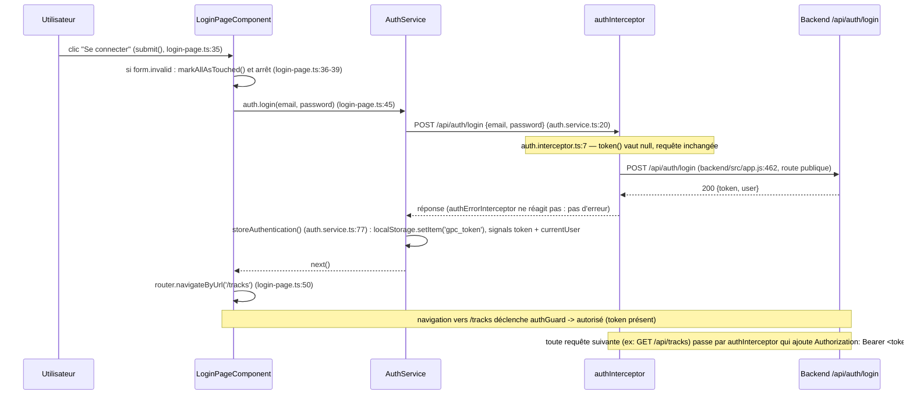
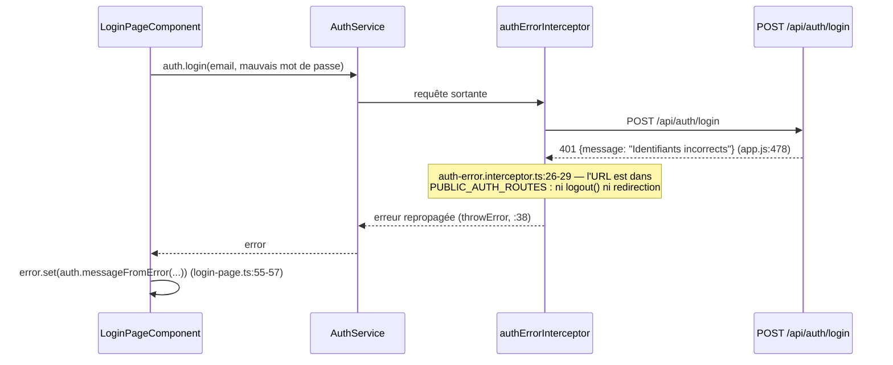

# Mission 0 — Schéma annoté du flux de connexion & Signal vs localStorage

> Brouillon fourni par l'assistant IA. À relire, corriger si besoin, et à
> citer/joindre comme livrable "schéma annoté du flux de connexion" et
> "explication Signal vs localStorage" du TP1.
>
> **Relecture de conformité au code** : le diagramme et les annotations
> ci-dessous ont été recontrôlés ligne par ligne contre le code actuel (après
> les correctifs TP1 et la réécriture de la bibliothèque en TP2). Deux écarts
> ont été corrigés : le chemin d'erreur (connexion refusée) manquait, et le
> comportement de `authErrorInterceptor` sur les routes publiques n'était pas
> encore documenté (voir le §« Cas de la connexion refusée » ci-dessous).
> La cartographie complète de l'application est dans
> [`../mission0-cartographie.md`](../mission0-cartographie.md).

## Schéma annoté : clic sur « Se connecter »

### Annotations — qui fait quoi

| Étape | Fichier:ligne | Rôle |
|---|---|---|
| Déclenchement | `login-page.ts:35` (`submit()`) | Lit les valeurs du `FormGroup` (`getRawValue()`, :41), appelle le service — ne touche jamais `HttpClient` directement |
| Garde de formulaire | `login-page.ts:36-39` | Si le formulaire est invalide, marque les champs comme « touchés » pour faire apparaître les messages, et **n'émet aucune requête** |
| Appel HTTP | `auth.service.ts:18-22` (`login()`) | `POST /api/auth/login`, puis `tap()` sur la réponse pour stocker l'authentification |
| Interception sortante | `auth.interceptor.ts:6-16` | Ajoute `Authorization: Bearer <token>` si un token existe déjà (absent ici, car pas encore connecté) |
| Interception entrante | `auth-error.interceptor.ts:20-41` | Sur un `401` **hors route publique**, déconnecte et redirige (non déclenché ici : succès) |
| Persistance | `auth.service.ts:77-86` (`storeAuthentication()`) | `localStorage.setItem('gpc_token', ...)` dans un `try/catch` + mise à jour des Signals `token` et `currentUser` |
| Navigation | `login-page.ts:50` | `router.navigateByUrl('/tracks')` |
| Garde de route | `auth.guard.ts:6-11` | Vérifie `auth.token()` avant d'autoriser l'accès à `/tracks` |

### Cas de la connexion refusée (mot de passe invalide)

C'est le deuxième cas demandé par le Checkpoint Network du TP1, et c'est celui
qui a demandé un correctif après coup. Le chemin est le suivant :

Pourquoi cette exclusion des routes publiques est indispensable : sans elle,
`authErrorInterceptor` appelait `logout()` puis `router.navigateByUrl('/login')`
sur **tout** `401`, y compris celui d'un mot de passe refusé. La navigation
recréait le composant `LoginPageComponent`, donc remettait son Signal `error()`
à `''` : l'utilisateur voyait sa page se recharger sans jamais lire pourquoi sa
connexion avait échoué. La liste `PUBLIC_AUTH_ROUTES`
(`auth-error.interceptor.ts:13`) distingue les deux sens possibles d'un `401` :

| `401` reçu sur… | Signification | Réaction attendue |
|---|---|---|
| `/api/auth/login`, `/api/auth/register` | identifiants refusés | message dans le formulaire, on **reste** sur la page |
| toute autre route (`/api/users/me`, `/api/tracks/...`) | token absent, invalide ou expiré | `logout()` + redirection vers `/login` |

Le message affiché vient de `AuthService.messageFromError()`
(`auth.service.ts:57-75`) : elle réutilise le `{ message }` français déjà
renvoyé par le backend quand il est présent, traite le cas particulier du
statut `0` (« Serveur injoignable »), et retombe sinon sur un libellé fourni par
l'appelant. Elle n'affiche jamais l'objet d'erreur brut.

## Routes publiques vs protégées (`API_CONTRACT.md`)

- **Publiques** (pas de JWT) : `GET /api/health`, `POST /api/auth/register`,
  `POST /api/auth/login`
- **Protégées** (JWT requis) : `GET`/`PUT` `/api/users/me`,
  `GET`/`POST`/`DELETE` `/api/tracks*`

Le détail (déclaration backend ligne par ligne, rôle exact de `/api/health`, et
la différence entre la protection Angular et la protection serveur) est dans
[`../mission0-cartographie.md`](../mission0-cartographie.md#6-routes-publiques-et-routes-protégées).

## Signal vs `localStorage` — quelle différence, et pourquoi les deux ?

Ce sont deux mécanismes complémentaires, pas interchangeables :

| | Signal (`token`, `currentUser`) | `localStorage` |
|---|---|---|
| **Où ça vit** | En mémoire, dans le processus JavaScript de l'onglet | Sur le disque, persistant entre les sessions du navigateur |
| **Durée de vie** | Disparaît au rafraîchissement de la page (F5) ou à la fermeture de l'onglet | Survit au rafraîchissement, à la fermeture du navigateur, au redémarrage de la machine |
| **Réactivité** | Angular réagit automatiquement aux changements (le template se met à jour tout seul via `@if`, interpolation, etc.) | Aucune réactivité : lire `localStorage` ne déclenche rien dans l'UI, il faut le faire manuellement |
| **Rôle dans l'appli** | Source de vérité *pendant que l'appli tourne*, consommée par les composants | Mémoire *entre deux chargements* de l'appli |

### Pourquoi c'est important ici

- Au démarrage (`auth.service.ts`), le Signal `token` est **initialisé** à partir de
  `localStorage.getItem('gpc_token')` — c'est le pont entre les deux mondes :
  `localStorage` survit au rafraîchissement, le Signal en reprend la valeur
  pour que l'UI réactive fonctionne à nouveau immédiatement.
- En revanche, `currentUser` (les infos du profil) n'est **pas** persisté dans
  `localStorage` — il repart à `null` à chaque rafraîchissement. C'était
  exactement le Problème 2 identifié en Mission 1 : sans rechargement
  automatique du profil au démarrage du composant, l'utilisateur se
  retrouvait avec un token valide mais un profil vide après un F5. La
  correction (`ngOnInit` → `load()`) recharge les données manquantes depuis
  l'API à chaque arrivée sur `/profile`, plutôt que de dupliquer le profil
  entier dans `localStorage` (ce qui poserait un problème de fraîcheur des
  données si elles changent côté serveur).
- `logout()` doit nettoyer les **deux** : `localStorage.removeItem('gpc_token')`
  *et* remettre les Signals à `null`, sinon l'un des deux resterait
  incohérent avec l'autre.

### Compléments après relecture du code actuel

**1. La clé de stockage est une constante nommée.**
`const TOKEN_KEY = 'gpc_token'` (`../../src/app/shared/services/auth.service.ts:8`).
Les trois accès à `localStorage` l'utilisent — `setItem` (:79), `removeItem`
(:43), `getItem` (:90) — ce qui évite une faute de frappe qui laisserait un
token orphelin dans le navigateur.

**2. Les trois accès à `localStorage` sont protégés par `try/catch`.**
C'est un point important à savoir expliquer, car ce n'est pas de la
sur-ingénierie : `localStorage` **peut lever une exception**, ou renvoyer
`null` alors qu'une valeur a été écrite, dans plusieurs situations réelles :

- navigation privée ou stockage de site bloqué par l'utilisateur ;
- quota de stockage dépassé (`QuotaExceededError` sur `setItem`) ;
- environnement sans DOM complet, typiquement les tests unitaires — c'est
  exactement le problème qui a nécessité le polyfill de `src/test-setup.ts`
  (voir [`README.md`](./README.md)).

La stratégie retenue est différente selon le sens de l'accès :

| Accès | Ligne | Comportement en cas d'échec | Conséquence pour l'utilisateur |
|---|---|---|---|
| Lecture au démarrage | `auth.service.ts:88-94` | renvoie `null` | l'application démarre déconnectée au lieu de planter au chargement |
| Écriture après login | `auth.service.ts:77-83` | on ignore l'échec, les Signals sont quand même mis à jour | la session **fonctionne normalement** mais ne survivra pas à un F5 |
| Suppression au logout | `auth.service.ts:41-50` | on ignore l'échec, les Signals passent quand même à `null` | la déconnexion est effective dans l'onglet en cours |

La règle commune : **le Signal reste la source de vérité pour la session en
cours**, `localStorage` n'est qu'un confort de persistance. Une application qui
plante parce qu'elle n'a pas pu écrire un cache serait plus grave que la perte
de ce cache.

**3. Le JWT n'est jamais écrit dans les logs.** Aucun `console.log` de
l'application n'affiche `token()` ni `response.token`. Les traces se limitent à
l'étape atteinte, par exemple `console.debug('[LoginPage] Connexion réussie')`
(`../../src/app/components/login-page/login-page.ts:48`). Un JWT recopié dans
une capture d'écran ou un prompt d'assistant permettrait une usurpation de
compte jusqu'à son expiration (2 h, `backend/src/app.js:298`).
