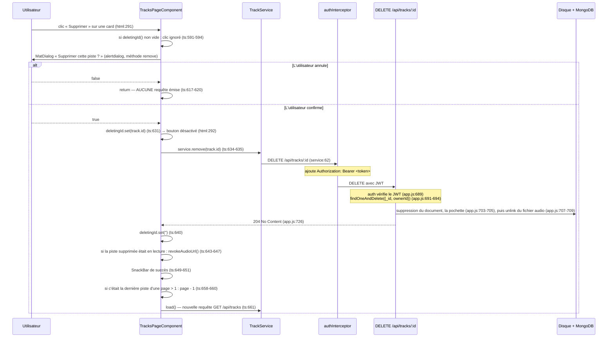

# TP3 / Mission 5 — Suppression d'une piste

Livrable TP3 : « suppression fonctionnelle d'une piste ». Cette mission demande
aussi d'**expliquer pourquoi le guard Angular et l'interface ne suffisent pas à
sécuriser la suppression** — c'est le §5 de ce document.

Chemins frontend relatifs à `frontend-starter/`, chemins backend à la racine du
dépôt. Chaque affirmation porte son `fichier:ligne`.

> **Mise à jour après la refonte de l'interface** : la confirmation de suppression
> n'est plus un `window.confirm()` mais un **dialogue Material** (`MatDialog`,
> composant `ConfirmDeleteDialogComponent`, dossier
> `src/app/components/tracks-page/confirm-delete-dialog/`). Les paragraphes
> concernés ci-dessous ont été corrigés (§1, §2, §3.2, §5).
> **Numéros de ligne** : re-vérifiés sur le **code figé** (`tracks-page.ts` 1039
> lignes, `backend/src/app.js` 885 lignes). Tout changement ultérieur les décalera ;
> le **nom de la méthode ou de l'élément**, cité à côté, fait foi
> (`grep -n "nom" src/app/components/tracks-page/tracks-page.ts`).

---

## 1. Tableau de repérage

| Élément demandé par le sujet | Fichier | Méthode / élément | Ligne |
|---|---|---|---|
| Action « Supprimer » dans chaque card | `src/app/components/tracks-page/tracks-page.html` | `<button class="delete" (click)="remove(track)">` | 288-297 |
| Confirmation avant suppression | `src/app/components/tracks-page/tracks-page.ts` | `this.dialog.open(ConfirmDeleteDialogComponent, …)` dans `remove()` ; le dialogue est dans `confirm-delete-dialog/` | (voir `remove`) |
| État de suppression (anti-double-clic) | `src/app/components/tracks-page/tracks-page.ts` | signal `deletingId` | 119, posé en 344 |
| L'appel HTTP | `src/app/shared/services/track.service.ts` | `remove(id)` : `this.http.delete<void>(...)` | 61-63 |
| Message de succès (SnackBar) | `src/app/components/tracks-page/tracks-page.ts` | `this.snackBar.open(...)` | 649-651 |
| Message d'erreur (SnackBar) | `src/app/components/tracks-page/tracks-page.ts` | `this.snackBar.open(this.deleteErrorMessage(error), ...)` | 666-668 |
| Mise à jour de la page après suppression | `src/app/components/tracks-page/tracks-page.ts` | `this.load()` | 371 (succès) et 380 (erreur) |
| Piste disparue ou appartenant à autrui | `src/app/components/tracks-page/tracks-page.ts` | `deleteErrorMessage()` | 681-694 |
| La route backend | `backend/src/app.js` | `app.delete("/api/tracks/:id", auth, ...)` | 689 |

---

## 2. Le flux complet



---

## 3. Les sept décisions de conception, et pourquoi

### 3.1 L'appel HTTP est dans le service, pas dans le composant

`TrackService.remove()` (`track.service.ts:61-63`) :

```ts
/** Suppression d'une piste : `204 No Content` côté backend. */
remove(id: string): Observable<void> {
  return this.http.delete<void>(`/api/tracks/${id}`);
}
```

C'est une exigence explicite du sujet (« le composant ne doit pas appeler
directement `HttpClient` »). Le raisonnement complet est en
[`restitution-orale.md`](./restitution-orale.md#1-pourquoi-la-suppression-passe-t-elle-par-un-service-).

Le typage `<void>` n'est pas décoratif : le backend répond `204 No Content`
(`backend/src/app.js:726` → `res.status(204).end()`), donc **sans corps**. Le
composant ne lit rien dans le callback `next` (`tracks-page.ts:638`) : il
n'utilise que le fait que la réponse est arrivée. Écrire `delete<Track>` serait
un mensonge de typage : le compilateur laisserait passer un `response.title` qui
serait `undefined` à l'exécution.

### 3.2 La confirmation se fait **avant** l'appel, et une annulation n'émet rien

Dans `remove()` (`tracks-page.ts`), la suppression n'est lancée (`deleteTrack()`)
que si le dialogue se ferme avec la valeur `true`. Un clic sur « Annuler », la
touche Échap ou un clic à l'extérieur ferment le dialogue **sans** `true` :
la méthode fait alors un `return` et **aucune requête ne part** — ce que vérifie
le test « « Annuler » ferme le dialogue sans aucune requête DELETE »
(`tracks-page.spec.ts`, bloc « dialogue de confirmation réel (MatDialog) »).

**Historique, à connaître** : la première version utilisait `window.confirm()`,
choix simple mais limité : il bloque le fil d'exécution du navigateur, n'est pas
stylable et ses libellés ne sont pas personnalisables. Il a été remplacé par un
`MatDialog`, qui apporte :

| Apport | Comment |
|---|---|
| Rôle accessible adapté | `role: 'alertdialog'`, `ariaModal: true`, description liée (`ariaDescribedBy: 'confirm-delete-description'`) |
| Focus géré | `autoFocus: 'first-tabbable'`, `restoreFocus: true` : le focus est piégé dans le dialogue puis rendu au bouton d'origine |
| Libellés explicites | « Supprimer cette piste ? », le titre de la piste en gras, « Cette action est irréversible. », boutons « Annuler » et « Supprimer » (`confirm-delete-dialog.html`) |
| Aucun double dialogue | un champ `confirmingDelete` ignore un second clic tant que le dialogue est ouvert (test « ignore un second clic tant que le dialogue est ouvert ») |

Le message cite le titre de la piste et le mot « irréversible » : une
confirmation qui ne dit pas *sur quoi* elle porte ne protège de rien. Ce
composant est désormais **partagé** avec le retrait d'une pochette (champ
`data.target`), ce qui relève de la documentation des pochettes.

### 3.3 `deletingId` : un signal d'identifiant, pas un booléen

`tracks-page.ts:247` : `readonly deletingId = signal('')`.

Pourquoi un identifiant et non un `boolean` ? Parce qu'il sert à deux choses à
la fois :

1. **Garde globale anti-double-clic** : `if (this.deletingId() || …)` (`:591`) — une
   chaîne non vide est *truthy*, donc toute suppression en cours bloque la
   suivante. C'est une **double** protection, en plus du bouton désactivé dans
   le template : un utilisateur qui double-clique très vite, ou un clic simulé,
   ne peut pas déclencher deux `DELETE`.
2. **Ciblage de l'affichage** : le template compare
   `deletingId() === track.id` (`tracks-page.html:292`, `:293`, `:296`) pour ne
   désactiver et ne passer en « Suppression… » que **la card concernée**, pas
   toutes. Un booléen aurait grisé toute la liste.

Le signal est remis à `''` dans les **deux** branches, succès (`:640`) et erreur
(`:665`). Un oubli dans la branche d'erreur laisserait l'interface bloquée
définitivement après un seul échec — c'est le bug classique de ce genre de garde.

### 3.4 SnackBar Material pour le retour utilisateur

`MatSnackBar` est injecté en `tracks-page.ts:103` et utilisé aux deux issues :

| Issue | Ligne | Message | Durée |
|---|---|---|---|
| Succès | 649-651 | `« <titre> » a été supprimé.` | 4 s |
| Erreur | 666-668 | le retour de `deleteErrorMessage(error)` | 6 s |

Deux détails de conception :

- **La durée d'erreur est plus longue** (6 s contre 4 s). Un message d'erreur
  demande à être lu et compris ; une confirmation de succès est juste un accusé
  de réception.
- **Le message de succès cite le titre.** Après un rechargement de liste, la
  card a disparu : sans le titre dans le message, l'utilisateur ne saurait pas
  *laquelle* a été supprimée s'il a cliqué par erreur.

C'est le composant demandé par le sujet (« composant Angular SnackBar »). Il
vient de `@angular/material` (`package.json` : `@angular/material` et
`@angular/cdk`). À noter : l'ajout de Material explique l'essentiel de la hausse
du poids du bundle (voir le bilan de build dans `RAPPORT_IA_MODELE.md`).

### 3.5 Le lecteur audio ne doit pas rester sur une ressource disparue

`tracks-page.ts:643-647` :

```ts
if (this.playingTrack()?.id === track.id) {
  this.revokeAudioUrl();
  this.playingTrack.set(undefined);
  this.audioError.set('');
}
```

C'est un cas auquel on ne pense pas spontanément : supprimer la piste qu'on est
en train d'écouter. Sans ce bloc, le lecteur `<audio>` resterait affiché et
continuerait même de jouer — car son `src` est une URL `blob:` qui pointe vers
de la mémoire locale, totalement indépendante du serveur. L'utilisateur
entendrait un morceau qu'il vient de supprimer.

Les trois lignes traitent les trois conséquences : libérer la mémoire du `Blob`
(cf. [`../tp2/questions-memoire-buffering-streaming.md` Q5](../tp2/questions-memoire-buffering-streaming.md)),
retirer le lecteur du DOM (le template le conditionne à `audioUrl()`,
`tracks-page.html:402`) et effacer une éventuelle erreur audio devenue sans
objet.

### 3.6 Retour à la page précédente si on vide une page

`tracks-page.ts:658-660` :

```ts
if (this.tracks().length === 1 && this.page() > 1) {
  this.page.update((current) => current - 1);
}
```

Scénario : 6 pistes, 5 par page, on est en page 2 (qui contient une seule
piste), on la supprime. Sans ce bloc, `load()` redemanderait la page 2 — qui
n'existe plus — et afficherait une liste vide alors que la bibliothèque contient
encore 5 pistes. L'utilisateur croirait avoir tout perdu.

Deux conditions, toutes les deux nécessaires : `length === 1` (c'était la
**dernière** de la page affichée) et `page() > 1` (on n'est pas déjà sur la
première — vider la page 1 est un état vide légitime, et le template affiche alors l'état « Votre bibliothèque est vide », branche
`@else` de `tracks-page.html`, voir [`../bonus/filtre-par-titre.md` §3.4](../bonus/filtre-par-titre.md)).

### 3.7 On recharge depuis le serveur, on ne retire pas l'élément localement

`this.load()` est appelé dans les **deux** branches : succès (`:661`) et erreur
(`:670`).

Retirer la piste du tableau local (`tracks.update(t => t.filter(...))`) aurait
été plus rapide et sans requête — mais faux, pour trois raisons :

1. Le nombre total et le nombre de pages (`total`, `pages`) seraient périmés :
   les boutons de pagination afficheraient des bornes fausses.
2. La page afficherait 4 éléments sur 5, sans remonter la piste suivante qui
   devrait maintenant y figurer.
3. Un autre onglet a peut-être ajouté ou supprimé des pistes entre-temps.

**Le rechargement dans la branche d'erreur est le plus intéressant** (`:670`,
commenté « la liste peut être désynchronisée »). Si le `DELETE` échoue en `404`,
c'est très probablement que la piste **a déjà été supprimée ailleurs** : la
bonne réaction est donc d'aller resynchroniser l'affichage, pas de laisser à
l'écran une card qui ne correspond plus à rien.

---

## 4. Le cas `404` : pourquoi le message reste prudent

`deleteErrorMessage()` (`tracks-page.ts:681-694`) traduit le statut HTTP :

| Statut | Message affiché | Ligne |
|---|---|---|
| `404` | « Piste introuvable ou déjà supprimée. » | 684 |
| `401` | « Session expirée : reconnectez-vous pour supprimer une piste. » | 687 |
| `0` | « Serveur injoignable, suppression impossible. » | 690 |
| autre | le `{ message }` du backend, sinon « Suppression impossible, réessayez. » | 693 |

**Pourquoi « introuvable **ou** déjà supprimée » et pas une affirmation
franche ?** À cause de la requête backend, `backend/src/app.js:691-694` :

```js
const track = await Track.findOneAndDelete({
  _id: req.params.id,
  ownerId: req.auth.sub,
}).select("+storedName +coverStoredName");
```

Le `select("+storedName +coverStoredName")` rappelle les deux champs masqués par
défaut du schéma : le serveur supprime **aussi le fichier de pochette** de la piste
(avant le fichier audio, pour ne jamais laisser une pochette orpheline), puis répond
`204` (`backend/src/app.js`, route `app.delete("/api/tracks/:id")`). Le filtre porte sur **deux** critères. Trois situations différentes donnent donc
le même résultat `null`, et donc le même `404 { message: "Piste inconnue" }`
(`app.js:696-699`) :

1. la piste n'a jamais existé ;
2. la piste existait et a déjà été supprimée (autre onglet, autre appareil) ;
3. la piste existe mais **appartient à quelqu'un d'autre**.

**C'est volontaire, et c'est une mesure de sécurité.** Répondre `403 Forbidden`
dans le cas 3 confirmerait à l'attaquant que cet identifiant correspond à une
piste réelle : il pourrait énumérer les identifiants valides et déduire la
taille de la bibliothèque des autres utilisateurs. C'est une **fuite
d'information par le code d'erreur**. En répondant uniformément `404`, le
serveur ne dit rien de plus que « pas de piste avec cet identifiant *pour
vous* ».

Conséquence côté client : **il est impossible de distinguer les trois cas**.
Écrire « cette piste ne vous appartient pas » serait une affirmation que le
frontend n'a aucun moyen de vérifier — et elle serait fausse dans le cas 2, le
plus fréquent. Le message retenu est honnête sur ce que l'on sait. C'est
exactement le même raisonnement que pour la lecture audio (`audioErrorMessage()`,
`tracks-page.ts:1028`).

> **À retenir pour l'oral** : un message d'erreur ne doit jamais affirmer plus
> que ce que le code permet de savoir. Et un code HTTP volontairement peu
> bavard peut être un choix de sécurité, pas une négligence.

---

## 5. Pourquoi le guard Angular et l'interface ne suffisent pas

Question explicitement posée par le sujet. Réponse courte : **parce que tout ce
qui s'exécute dans le navigateur est sous le contrôle de l'utilisateur.**

### Ce que le frontend met en place, et ce que ça vaut

| Protection frontend | Ligne | Contournement | Temps nécessaire |
|---|---|---|---|
| `authGuard` sur la route `/tracks` | `auth.guard.ts:6-11` | écrire n'importe quelle chaîne dans `localStorage.gpc_token` : le guard ne vérifie que la **présence** | quelques secondes dans la console |
| Bouton « Supprimer » désactivé | `tracks-page.html:292` | retirer l'attribut `disabled` dans l'inspecteur, ou appeler la méthode directement | quelques secondes |
| Garde `deletingId` | `tracks-page.ts:591` | ne pas utiliser l'interface du tout | — |
| Dialogue de confirmation | `remove()` dans `tracks-page.ts` | ne pas utiliser l'interface du tout | — |

Et surtout : **rien n'oblige à utiliser l'application.** Un `curl` suffit :

```bash
curl -X DELETE http://localhost:3000/api/tracks/<id> \
  -H "Authorization: Bearer <votre-token>"
```

Aucune ligne de code Angular n'est exécutée. Le guard, le bouton, la
confirmation : rien n'existe sur ce chemin.

### Ce que le backend met en place, et pourquoi c'est la vraie sécurité

Deux niveaux, dans cet ordre, sur `app.delete("/api/tracks/:id", auth, ...)`
(`backend/src/app.js:689`) :

**Niveau 1 — le middleware `auth` (`app.js:303-324`) : *qui* êtes-vous ?**
Il exige un en-tête commençant par `Bearer ` (`:309-312`) puis appelle
`jwt.verify(raw.slice(7), SECRET)` (`:317`). Cette vérification est
**cryptographique** : elle valide la signature avec le secret serveur, et
l'expiration (2 h, `:298`). Un token fabriqué ou modifié ne passe pas : on ne
peut pas signer sans connaître `SECRET`, qui ne quitte jamais le backend. En cas
d'échec : `401 { message: "Jeton invalide ou expiré" }` (`:322`). L'identité
extraite est placée dans `req.auth`, et `req.auth.sub` contient l'`_id` MongoDB.

**Niveau 2 — le filtre `ownerId` (`app.js:691-694`) : cette piste est-elle
*à vous* ?**
C'est le point décisif. Même avec un **JWT parfaitement valide**, la requête
`findOneAndDelete({ _id: req.params.id, ownerId: req.auth.sub })` ne trouve
rien si la piste appartient à un autre utilisateur, et le serveur répond `404`.

L'élément clé : `ownerId` est comparé à `req.auth.sub`, c'est-à-dire à une
valeur issue **du token signé**, pas du corps ni de l'URL de la requête. Il
n'existe aucun champ que le client puisse falsifier pour se faire passer pour un
autre propriétaire. C'est la même propriété qui sécurise la mise à jour du
profil (voir
[`../mission1/questions-reponses.md`](../mission1/questions-reponses.md#ce-que-la-sécurité-doit-à-cette-architecture)).

### La formulation à retenir

> Le frontend décide ce que l'utilisateur **voit** et ce qu'il peut faire
> **commodément**. Le backend décide ce qui **arrive réellement aux données**.
> Un guard qui empêche d'afficher une page n'empêche pas d'appeler l'API.

Autrement dit, les protections frontend sont de l'**ergonomie** : elles évitent
des requêtes vouées à l'échec et des erreurs de manipulation. Elles ne sont pas
inutiles — mais elles ne sont pas de la sécurité, et la sécurité serait intacte
si on les retirait toutes. C'est le même raisonnement que pour la validation de
fichier (voir
[`../tp2/upload-et-lecture-audio.md` §6](../tp2/upload-et-lecture-audio.md#6-validation-frontend-et-validation-backend))
et pour `authGuard` face au middleware `auth` (voir
[`../mission0-cartographie.md`](../mission0-cartographie.md#deux-notions-de--protection--à-ne-pas-confondre)).

---

## 6. Vérifications

### Tests automatisés (réellement exécutés)

`src/app/components/tracks-page/tracks-page.spec.ts` contient **6 tests** sur la
suppression (`tracks-page.spec.ts:125-228`) :

| Test | Ligne | Ce qu'il verrouille |
|---|---|---|
| Aucune requête `DELETE` si l'utilisateur refuse la confirmation | 126 | la confirmation est bien un préalable, pas un affichage |
| `DELETE /api/tracks/:id` puis rechargement de la liste | 141 | l'URL, la méthode, et le `load()` qui suit |
| Message de succès après suppression réussie | 160 | le retour utilisateur existe et cite la piste |
| Un `404` donne un message, sans planter | 172 | le cas « supprimée ailleurs » est traité |
| Second clic ignoré pendant une suppression | 192 | la garde `deletingId` fonctionne |
| Bouton désactivé sur la piste en cours de suppression | 210 | le ciblage par identifiant, pas toute la liste |

À quoi s'ajoutent, dans `src/app/shared/services/track.service.spec.ts`
(`:273-305`) : « appelle `DELETE /api/tracks/:id` » (`:280`) et « propage un
`404` quand la piste a déjà été supprimée ailleurs » (`:292`).

### Vérifications API (exécutées en ligne de commande contre le backend)

Obtenues par l'orchestrateur avec `curl` contre l'API en fonctionnement, sur le
compte de démonstration :

| Vérification | Résultat réel |
|---|---|
| `DELETE /api/tracks/:id` avec JWT valide, piste possédée | `204`, sans corps |
| `DELETE` sur une piste déjà supprimée | `404 {"message":"Piste inconnue"}` |

> Ces vérifications portent sur le **contrat HTTP**, en ligne de commande. Elles
> ne remplacent pas les captures Network que le binôme doit produire dans le
> navigateur : elles ne prouvent rien sur la confirmation, le SnackBar ou le
> rechargement de la liste, qui sont du ressort de l'interface.

### À vérifier soi-même

**[À COMPLÉTER PAR LE BINÔME]** — le sujet exige « une requête `DELETE` après
confirmation » dans l'onglet Network.

1. Ouvrir `/tracks` connecté, DevTools (F12) → onglet **Network**, filtre
   **XHR/fetch**, vider la liste.
2. Cliquer « Supprimer » sur une piste, puis **Annuler** dans la boîte de
   dialogue. Constater qu'**aucune ligne n'apparaît** dans Network. C'est la
   première moitié de la preuve, et on l'oublie souvent.
3. Recliquer, puis **Confirmer**. Relever pour la requête `DELETE` : la méthode,
   l'URL (elle doit contenir l'`id` de la piste), la **présence** de l'en-tête
   `Authorization` — ne recopiez jamais sa valeur — et le statut `204`.
   Remarquer que l'onglet *Response* est **vide** : c'est normal, `204` signifie
   « pas de contenu ».
4. Constater la requête `GET /api/tracks?page=...` qui **suit immédiatement** :
   c'est le `load()` de rechargement.
5. Vérifier le SnackBar en bas de l'écran et la disparition de la card.
6. *Cas « supprimée ailleurs »* : ouvrir l'application dans **deux onglets** sur
   la même liste. Supprimer une piste dans l'onglet A. Dans l'onglet B (qui
   affiche encore la card), cliquer « Supprimer » sur cette même piste. Relever
   le `404`, le message du SnackBar, et le fait que la liste se resynchronise.
7. *Preuve que le frontend n'est pas la sécurité* : dans la console de l'onglet,
   altérer un caractère du token (`localStorage.setItem('gpc_token', ...)`) puis
   tenter une suppression. Relever le `401` et la redirection vers `/login`.
8. Vérifier enfin, comme l'exige le sujet, qu'**aucune donnée sensible** n'est
   journalisée dans la console : les traces ne contiennent que des
   identifiants de pistes et des titres (`tracks-page.ts:592`, `:618`, `:639`,
   `:664`), jamais de token ni de mot de passe.

**Ce que chaque membre sait expliquer sans l'assistant** :
**[À COMPLÉTER PAR LE BINÔME]** — les deux questions probables à l'oral sont
« pourquoi la suppression passe-t-elle par un service ? » et « comment le
backend protège-t-il la suppression ? ». Les réponses sont dans
[`restitution-orale.md`](./restitution-orale.md) ; notez ici, chacun pour soi,
ce que vous savez redire sans notes.
